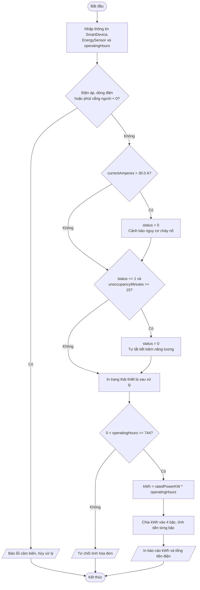

# BÁO CÁO THIẾT KẾ – Module Quản lý Cụm Thiết bị Phòng Thông minh bằng Struct

## 1. Phân tích bài toán (Input / Output)

### 1.1 Input

**struct SmartDevice** (thiết bị thông minh)

| Trường | Kiểu | Ý nghĩa | Ràng buộc |
|---|---|---|---|
| `deviceID` | `int` | Mã định danh thiết bị | Số nguyên |
| `deviceName` | `char[50]` | Tên thiết bị | Nhập bằng `fgets()`, bỏ `\n` |
| `status` | `int` | 1: đang bật, 0: đã tắt | Chỉ nhận 0 hoặc 1 |
| `ratedPowerKW` | `float` | Công suất định mức (kW) | > 0 |

**struct EnergySensor** (cảm biến điện năng & hiện diện)

| Trường | Kiểu | Ý nghĩa | Ràng buộc |
|---|---|---|---|
| `voltageVolts` | `float` | Điện áp đo được (V) | >= 0, âm là lỗi cảm biến |
| `currentAmperes` | `float` | Dòng điện đo được (A) | >= 0, âm là lỗi cảm biến |
| `unoccupancyMinutes` | `int` | Thời gian vắng người (phút) | >= 0, âm là lỗi cảm biến |

**Biến phụ trợ**: `operatingHours` (số giờ vận hành trong tháng, phải thỏa 0 < giờ <= 744), `kWh`, `tienDien`, các biến chia bậc `kwhBac1..4`, `tien1..4`.

### 1.2 Output
- Trạng thái thiết bị sau khi áp dụng luật tự động hóa (BẬT / TẮT).
- Cảnh báo nguy cơ cháy nổ (nếu dòng điện > 30.0 A) hoặc thông báo tự tắt tiết kiệm năng lượng (nếu vắng người >= 15 phút).
- Tổng điện năng `kWh` và tổng tiền điện (chưa VAT), kèm chi tiết từng bậc.
- Thông báo lỗi khi dữ liệu cảm biến âm hoặc số giờ vận hành không hợp lệ.

## 2. Đề xuất giải pháp

### 2.1 Dùng toán tử `.` để truy cập thành phần struct
Hai biến cấu trúc được khai báo trong `main()`:

```c
struct SmartDevice device;
struct EnergySensor sensor;
```

Mọi thuộc tính được đọc/ghi trực tiếp qua toán tử chấm:

- Kiểm tra dữ liệu cảm biến: `sensor.voltageVolts < 0 || sensor.currentAmperes < 0 || sensor.unoccupancyMinutes < 0`.
- Quy tắc an toàn: `if (sensor.currentAmperes > 30.0f) device.status = 0;` – dữ liệu của **cảm biến** quyết định trạng thái của **thiết bị**, hai struct phối hợp qua các thành phần.
- Quy tắc tiết kiệm: `if (device.status == 1 && sensor.unoccupancyMinutes >= 15) device.status = 0;`.
- Tính điện năng: `kWh = device.ratedPowerKW * operatingHours;`.

### 2.2 Thứ tự ưu tiên xử lý
1. Kiểm tra tính hợp lệ dữ liệu cảm biến (nếu sai: hủy xử lý).
2. **Ưu tiên 1** – Quá tải dòng điện (> 30.0 A): ngắt khẩn cấp.
3. **Ưu tiên 2** – Vắng người >= 15 phút khi thiết bị còn bật: tự tắt.
4. Kiểm tra số giờ vận hành (nếu sai: từ chối tính hóa đơn).
5. Tính kWh và tiền điện bậc thang.

Quy tắc an toàn đặt trước vì ngắt khẩn cấp quan trọng hơn tiết kiệm điện. Sau khi bị ngắt khẩn cấp thì `status == 0`, nên điều kiện tiết kiệm không kích hoạt lại, tránh thông báo trùng.

### 2.3 Tính tiền điện bậc thang EVN
Chia `kWh` vào từng bậc bằng chuỗi `if / else if`:

| Bậc | Khoảng kWh | Đơn giá (VNĐ/kWh) |
|---|---|---|
| 1 | 0 – 50 | 1.806 |
| 2 | 51 – 100 | 1.866 |
| 3 | 101 – 200 | 2.167 |
| 4 | > 200 | 2.729 |

```
kWh <= 50  : bac1 = kWh
kWh <= 100 : bac1 = 50, bac2 = kWh - 50
kWh <= 200 : bac1 = 50, bac2 = 50, bac3 = kWh - 100
còn lại    : bac1 = 50, bac2 = 50, bac3 = 100, bac4 = kWh - 200
Tổng tiền  = bac1*1806 + bac2*1866 + bac3*2167 + bac4*2729
```

## 3. Sơ đồ các bước xử lý



## 4. Các trường hợp kiểm thử

| # | Dữ liệu vào | Kết quả mong đợi | Kết quả chạy |
|---|---|---|---|
| 1 | Bật, 2.0 kW, 10 A, vắng 5 phút, 100 giờ | Vẫn BẬT; 200 kWh; 400.300 VNĐ | Đúng |
| 2 | Bật, 1.5 kW, **35 A**, 50 giờ | Cảnh báo, ngắt khẩn cấp (TẮT); 75 kWh; 136.950 VNĐ | Đúng |
| 3 | Bật, 1.0 kW, 12 A, **vắng 20 phút**, 300 giờ | Tự tắt tiết kiệm; 300 kWh; 673.200 VNĐ | Đúng |
| 4 | Dòng điện **-5 A** | Báo lỗi cảm biến, hủy xử lý | Đúng |
| 5 | Số giờ vận hành **800** (> 744) | Thiết bị xử lý bình thường, từ chối tính hóa đơn | Đúng |
| 6 | Biên: 30.0 A (không quá tải), vắng đúng 15 phút, 744 giờ | Tự tắt (>= 15); 744 kWh; 1.884.876 VNĐ | Đúng |

Kiểm tra tay trường hợp 3: 50 × 1.806 + 50 × 1.866 + 100 × 2.167 + 100 × 2.729 = 90.300 + 93.300 + 216.700 + 272.900 = 673.200 VNĐ.

## 5. Biên dịch và chạy

```bash
cd src
gcc -Wall -Wextra -std=c11 main.c -o main
./main
```

Chương trình chỉ dùng `struct`, toán tử `.`, `if/else`, `scanf`, `fgets`, `printf`; không có hàm tự định nghĩa và không có mảng cấu trúc.
